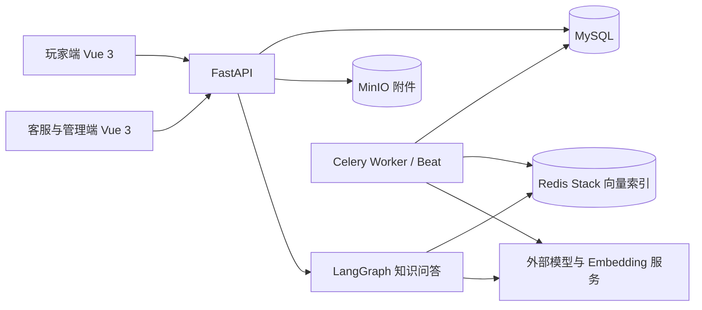

# GameCS · 游戏智能客服平台

GameCS 是一个前后端分离的游戏客服项目：玩家提交问题、查看进度并使用知识问答；客服处理工单、维护知识库并查看统计；管理员管理账号与审计记录。项目结合工单流转、异步 AI 分析、游戏隔离的知识检索和历史数据迁移工具，适合学习和演示客服业务流程。

> 项目仍在完善中，尚未宣称生产级上线。仓库不包含真实数据库、历史向量、附件、账号或 API 密钥；首次运行需要自行初始化数据和配置服务。

## 功能概览

| 角色 | 功能 |
| --- | --- |
| 玩家 | 注册登录、提交工单、补充信息、上传图片、查看处理进度、确认并评价、使用智能客服、查看热点关键词 |
| 客服 | 接单、公开回复、填写处理结果、完成工单、查看 AI 分析与相似工单、维护知识库 |
| 管理员 | 客服能力，以及账号角色和状态管理、操作审计 |

- **工单可靠性**：接单采用条件更新，避免同一工单被重复领取；回复支持请求去重；状态变更有权限和冲突检查。
- **知识问答**：按游戏检索知识并返回来源，校验已停用和过期的知识；无相关资料时明确提示并引导提交工单。
- **异步任务**：分析与知识索引使用任务记录、领取状态、重试和定时恢复；本地单进程模式不依赖 Redis。
- **可追踪与安全**：角色权限由后端校验；敏感接口设有限流；记录请求编号和工单操作，不在请求日志中记录密码和请求体。
- **设计与测试**：玩家端与工作台使用统一的夜航票券视觉；包含后端测试、隔离浏览器流程测试以及合成样本 AI 评测。

## 技术架构



| 部分 | 技术 |
| --- | --- |
| 前端 | Vue 3、TypeScript、Vite、Pinia、Vue Router、Element Plus |
| 后端 | Python、FastAPI、SQLAlchemy、Alembic、JWT、bcrypt |
| 数据与任务 | MySQL、Redis Stack、Celery、MinIO |
| AI | LangGraph、LangChain、OpenAI 兼容的对话与向量接口 |
| 验证 | pytest、Playwright、GitHub Actions |

开发环境的 `LOCAL_MODE=true` 使用 MySQL 保存本地向量和对话、进程内线程处理后台任务，仅适合单机开发。非本地模式使用 Redis Stack 和 Celery；具体配置见 [后端说明](backend/README.md)。

## 项目目录

```text
backend/              FastAPI、数据模型、迁移、后台任务、测试与 AI 评测
frontend/player/      玩家端
frontend/admin/       客服与管理员工作台
frontend/e2e/         隔离的浏览器端到端测试
infra/                Docker Compose 配置
```

## 快速开始：Docker Compose

需要 Docker Engine 和 Docker Compose。此方式创建独立的数据卷，不会导入其他数据库。

对象存储容器使用与 MinIO API 兼容的 Silo；本地开发仍可使用现有 MinIO。已有 Compose 数据卷升级前应先备份，并在隔离副本上验证对象读取和恢复；本项目尚未验证所有历史 MinIO 数据格式的升级兼容性。

1. 复制配置模板并填写**自己的**密码和密钥：

   ```bash
   cp infra/.env.example infra/.env
   ```

   Windows PowerShell 可使用 `Copy-Item infra/.env.example infra/.env`。`JWT_SECRET` 至少 32 个字符；`MYSQL_PASSWORD`、`MYSQL_ROOT_PASSWORD`、`MINIO_ACCESS_KEY` 和 `MINIO_SECRET_KEY` 均需设置。建议数据库密码使用 URL 安全字符，避免连接串解析问题。对话和向量服务密钥可暂留空，但相关 AI 功能不可用。

2. 启动服务：

   ```bash
   docker compose --env-file infra/.env -f infra/docker-compose.yml up -d --build
   ```

   API 容器启动时自动执行数据库迁移。首次启动后，玩家端为 <http://localhost:8080>，客服端为 <http://localhost:8081>，API 文档为 <http://localhost:8000/docs>。

3. 创建管理员，按提示设置用户名和密码：

   ```bash
   docker compose --env-file infra/.env -f infra/docker-compose.yml exec api python scripts/create_admin.py
   ```

   系统没有预置管理员密码。玩家可在玩家端自行注册；管理员可在工作台将账号设为客服。

4. **空数据库需要初始化游戏分类**。进入 MySQL：

   ```bash
   docker compose --env-file infra/.env -f infra/docker-compose.yml exec mysql mysql -u gamecs -p gamecs_new
   ```

   输入配置中的数据库密码后，仅在全新空数据库中执行以下示例数据：

   ```sql
   INSERT INTO categories (id, parent_id, name, level, active) VALUES
     (1, 0, '示例游戏', 1, 1),
     (2, 1, '正式版本', 2, 1),
     (3, 2, '账号问题', 3, 1);
   ```

   分类依次为游戏、版本、问题分类；若已有数据，请先检查现有 ID 和层级，勿重复执行。

5. 玩家登录后提交工单；客服登录后在“待接工单”接单、回复并填写处理结果；玩家确认解决并评价。客服可在“知识库”新增条目并检查索引状态。

停止服务使用 `docker compose --env-file infra/.env -f infra/docker-compose.yml down`。不要随意添加 `-v`，因为它会删除数据库等持久化数据卷。

## 本地开发

准备 Python 3.11+、Node.js 20+ 和 MySQL 8；附件需要 MinIO。以下示例使用 Windows PowerShell，在项目根目录执行：

```powershell
cd backend
python -m venv .venv
.\.venv\Scripts\python.exe -m pip install -e '.[test]'
Copy-Item .env.example .env
```

编辑 `backend/.env`：将 `DATABASE_URL` 指向独立的 MySQL 数据库，设置至少 32 字符的 `JWT_SECRET`，本地开发设 `LOCAL_MODE=true`。按需配置 `MINIO_*`、`DEEPSEEK_API_KEY` 和 `SILICONFLOW_API_KEY`。对已有数据先备份并在隔离副本验证迁移。

对话模型默认使用 DeepSeek；如需使用 SiliconFlow，请配置其密钥并设置 `CHAT_PROVIDER=siliconflow`，可用 `SILICONFLOW_CHAT_MODEL` 指定模型。向量索引仍需 SiliconFlow 密钥。服务商可能收费，切换后需重启后端与任务进程。

```powershell
.\.venv\Scripts\python.exe -m alembic upgrade head
.\.venv\Scripts\python.exe scripts\create_admin.py
.\.venv\Scripts\python.exe -m uvicorn app.main:app --host 127.0.0.1 --port 18765
```

另开两个终端，分别运行：

```powershell
cd frontend/player
npm ci
npm run dev
```

```powershell
cd frontend/admin
npm ci
npm run dev
```

玩家端：<http://127.0.0.1:5173>；客服端：<http://127.0.0.1:5174>；API 文档：<http://127.0.0.1:18765/docs>。本地 MySQL 空库同样需创建上面的三级示例分类。更多服务、任务和历史迁移说明见 [backend/README.md](backend/README.md)。

## 测试和评测

```powershell
cd backend
.\.venv\Scripts\python.exe -m pytest -q
```

在两个前端目录分别运行 `npm ci` 和 `npm run build`。浏览器流程测试：先安装后端、两端和 `frontend/e2e` 依赖，再在 `frontend/e2e` 运行 `npx playwright install chromium` 和 `npm test`。Windows 可通过 `E2E_PYTHON` 指定后端虚拟环境的 Python 路径。该测试使用独立端口和内存数据库，不连接业务数据。

浏览器测试的 AI 问答使用合成知识与模拟模型，附件页面测试使用模拟响应；真实模型测试见下方 AI 评测，真实 MinIO 附件读写与权限测试见后端测试说明。MySQL 集成测试需要一个独立、已迁移的空测试库，不能指向业务库。

MinIO 和 MySQL 的隔离集成测试需要额外环境变量，具体见 [后端测试说明](backend/README.md)。GitHub Actions 配置包括后端测试、迁移检查、MySQL 集成测试、前端构建和浏览器流程；运行状态以仓库实际 Actions 结果为准。

AI 评测使用合成数据，运行方式和结果见 [评测说明](backend/evaluation/README.md)、[初始评测记录](backend/evaluation/REPORT.md) 和 [扩展评测](backend/evaluation/EXPANDED_REPORT.md)。样本量较小，不代表真实用户场景的准确率；当前分段方案仍是实验候选，尚未替换现有知识索引。

## 接口与注意事项

接口前缀为 `/api/v1`；交互式文档提供具体参数。工单列表默认保持数组返回，使用 `include_total=true` 可获取分页总数；消息和评价分别通过 `/tickets/{id}/messages`、`/tickets/{id}/rating` 操作。

- 图片附件目前支持 PNG、JPEG、GIF，单张不超过 5 MB；需要正确配置 MinIO。
- 未配置模型或向量服务时，相应智能功能会返回不可用或等待索引；业务工单不依赖模型调用成功。
- 热点内容是平台工单关键词统计，不代表外部平台的全网舆情。
- 本地限流仅适合单进程；部署在反向代理或多实例环境时，应配置可信代理、Redis、HTTPS、备份与监控。
- 历史数据迁移工具需要用户自行准备来源数据；本仓库不分发历史数据或备份。迁移和数据一致性检查见 [后端说明](backend/README.md)。

## 许可证

本项目包含基于 RuoYi 的历史代码与改造内容，保留原有 [MIT 许可证及版权声明](LICENSE)。
